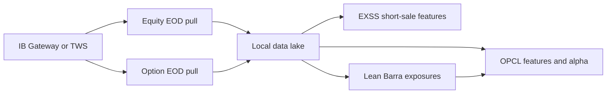

# IBKR market-data pipeline

Code for pulling end-of-day US equity and option data from Interactive Brokers, then building two research pipelines on top of it: **OPCL** (options open/close features and alpha) and **EXSS** (short-sale features), plus a **Lean Barra** risk-model approximation.

This repository is the code only. Price files, option chains, feature parquet, trained models, and vendor PDFs stay in a private data store and are not published here.

## Architecture



Connections are read-only and default to `127.0.0.1:7497` (TWS paper). Override the host and port with `IB_HOST` and `IB_PORT`.

## Layout

```text
coredata/exec/bin/     command-line entry points
coredata/exec/lib/     importable libraries
  opcl/                option open/close features, labels, model
  exss/                short-sale feature pipeline
  lean_barra/          Barra-style exposure and residualization
coredata/exec/schemas/ column specs and gateway notes
ops/exec/              small local helpers for the older scripts
```

`coredata/data/` is where a local checkout writes prices, option files, and features. Create it yourself; it is gitignored.

## Pipelines

| Stage | Entry point | Writes under `coredata/data/` |
| --- | --- | --- |
| Equity EOD | `coredata/exec/bin/fetch_mkt_data.py` | `price/<year>/*.equ_prices.csv` |
| Option EOD | `coredata/exec/bin/download_opt_history.py` | option EOD files in the CBOE v1.3 column layout |
| OPCL features | `coredata/exec/bin/build_sod_features.py` | `features/<year>/*.opcl.parq` |
| OPCL alpha | `coredata/exec/bin/opcl_train_predict.py` | `*.opcl.alpha.parq` |
| EXSS features | `coredata/exec/bin/build_exss_features.py` | `exss_features/<year>/` |
| Lean Barra | `coredata/exec/bin/build_lean_barra.py` | exposure panels used by residual labels |

OPCL runs in a reduced mode on IB price, volume, and open interest. It switches to the full participant-flow model only when real CBOE flow files are present on disk.

## Setup

```bash
python3 -m venv .venv
source .venv/bin/activate
pip install pandas numpy pyarrow xgboost ib_async ib_insync
```

Start TWS or IB Gateway with the socket API enabled and localhost-only access. Gateway paper port is `4002`; TWS paper port is `7497`.

```bash
python3 coredata/exec/bin/fetch_mkt_data.py -s 20260101 -e 20260131
python3 coredata/exec/bin/download_opt_history.py --as-of 20260515 --max-expirations 3 --strike-pct 0.15
python3 coredata/exec/bin/build_sod_features.py --for-date 20260515
python3 coredata/exec/bin/opcl_train_predict.py --for-date 20260515 --train-days 60
```

`BARRA_PROD_DATA_DIR` points residual checks at an external return panel. It defaults to `~/Downloads`.
